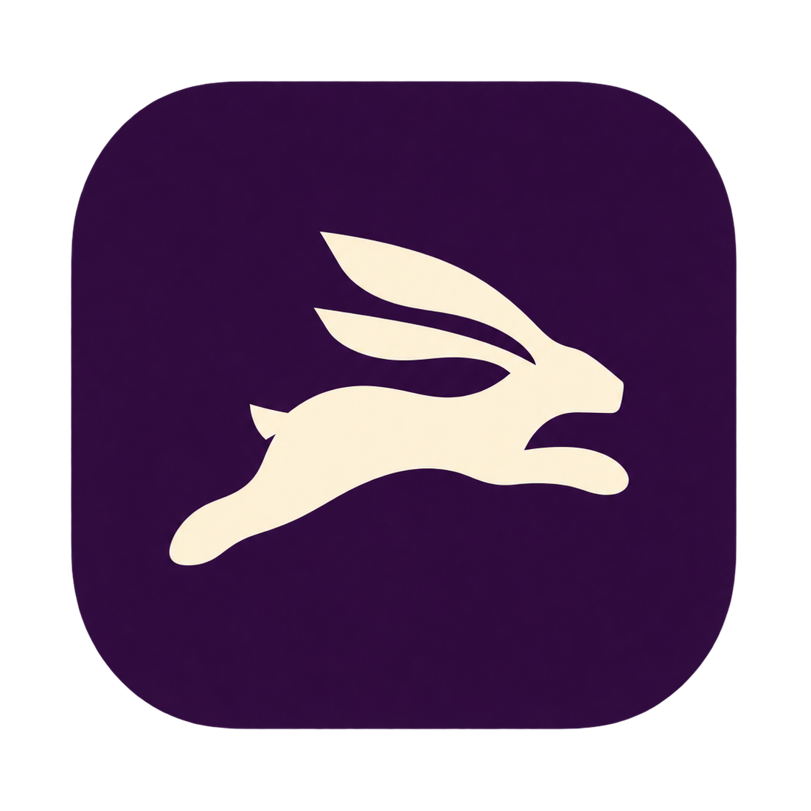

# Shiftland



Shiftland puts your OmniWM workspaces, displays, and keyboard shortcuts in a native macOS menu bar. See which apps are in each space, click to switch, and edit your setup from one window.

[Project website](https://ross-cripto.github.io/shiftland/) · [Report an issue](https://github.com/Ross-cripto/shiftland/issues/new)

## Find the code

| Path | What lives here |
| --- | --- |
| [macos/](macos/) | Swift package, native app, artwork, and tests |
| [web/](web/) | Public website source and assets. Start at [web/index.html](web/index.html) |
| [scripts/](scripts/) | Root build entry point |
| [AGENTS.md](AGENTS.md) | Code map, architecture, and development commands |

## Build from source

You need macOS 15 or later and Xcode's command-line tools to build the Swift app. Install [OmniWM](https://github.com/OmniNull/OmniWM) in `/Applications` or `~/Applications` and enable IPC in its menu to connect Shiftland. The verified pairing is macOS 15.5 with OmniWM 0.5.1.

```sh
git clone https://github.com/Ross-cripto/shiftland.git
cd shiftland
./scripts/build-app.sh
open -n "$PWD/.build/Shiftland.app" --args --preview --settings
```

Preview mode shows the Shiftland bar below your current bar and lets you switch spaces. In that mode, saving and registering the two workspace-zero shortcuts are disabled. To use the normal bar, quit the preview, stop your previous bar and any helper that registers `⌥0` or `⌥⇧0`, then open `.build/Shiftland.app`.

Open settings from Shiftland's menu or by right-clicking a workspace. When you save, Shiftland backs up OmniWM's `settings.toml` in `workspace-bar-backups/` and checks whether the file changed while the settings were open.

## Contributing

Use [GitHub Issues](https://github.com/Ross-cripto/shiftland/issues) for bugs and ideas. For a bug, include your macOS and OmniWM versions, display setup, and steps to reproduce it. Remove any window titles or file paths you want to keep private.

```sh
swift test --package-path macos -j 2 --filter WorkspaceBarTests
./scripts/build-app.sh
".build/Shiftland.app/Contents/MacOS/Shiftland" --diagnose
```

To work on the website, serve `web/` with `python3 -m http.server 8000 --bind 127.0.0.1 --directory web` and open `http://127.0.0.1:8000/`. The site is plain HTML, CSS, and JavaScript.

## License

Shiftland's source is available under the [MIT License](LICENSE). Shiftland communicates with a separately installed [OmniWM](https://github.com/OmniNull/OmniWM) through its `omniwmctl` command. OmniWM is distributed under its [own GPL-2.0 license](https://github.com/OmniNull/OmniWM/blob/main/LICENSE). The website uses Bricolage Grotesque under the [SIL Open Font License](web/assets/bricolage-OFL.txt).
